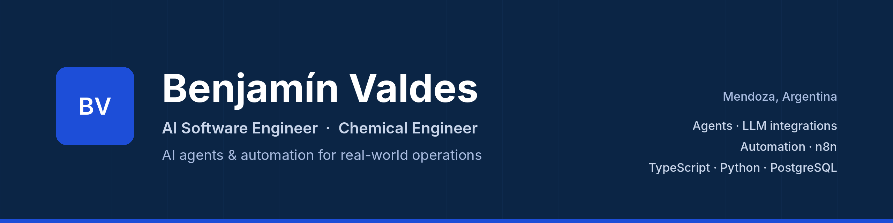

# Benjamín Valdes

### AI Software Engineer · Chemical Engineer · AI agents & automation for real-world operations

  
  
  
  
  
  
  
  
  
  

> Chemical engineer turned AI software engineer. ~8 years in industrial operations (production management and continuous improvement, leading a team of ~70) plus 3+ years building software. I design AI systems where **the model interprets and the code controls**: business rules, validation and permissions stay deterministic, so agents are safe to run in production.

## What I've worked on

- **AI operational assistant on WhatsApp** — Natural-language assistant for a poultry company to query, validate and create farm records. The LLM produces structured intents; application code handles schema validation, business rules, permissions and controlled PostgreSQL writes. Cut administrative workload by about half (≈ one FTE). *(LLMs · tool calling · Python · PostgreSQL)*
- **AI-assisted tender management platform** — Led architecture and development end to end for a regional accounting firm: AI document processing, centralized data and automated workflows. ~35% less workload for a 3-person admin team; became the client's primary tender system. *(Next.js · TypeScript · PostgreSQL)*
- **Subscription lifecycle automation** — Activations, cancellations, validation, error tracking and customer emails running on their own. Up to ~70% less manual effort. *(n8n · webhooks · Gmail API · PostgreSQL)*
- **Table tennis tournament platform** — Full-stack platform built for a table tennis club and running in production: public player registration, categories and rankings, group stages, results, standings and knockout brackets, with tournament formats generated automatically from the number of players. *(Next.js · TypeScript · PostgreSQL · Prisma · Supabase · Tailwind · Vercel)*
- **Fraud Prevention Software** `in progress` — Fraud detection platform: rule-based signals, anomaly detection, risk scoring and auditable investigation workflows, privacy-first. *(Python · SQL · Next.js)*

## How I work

Problem → process → solution → impact. I start from the business bottleneck, map the process with the people who run it, pick the simplest tool that solves it (automation, agent, app or a process change) and measure the result in hours and money.

## Connect

